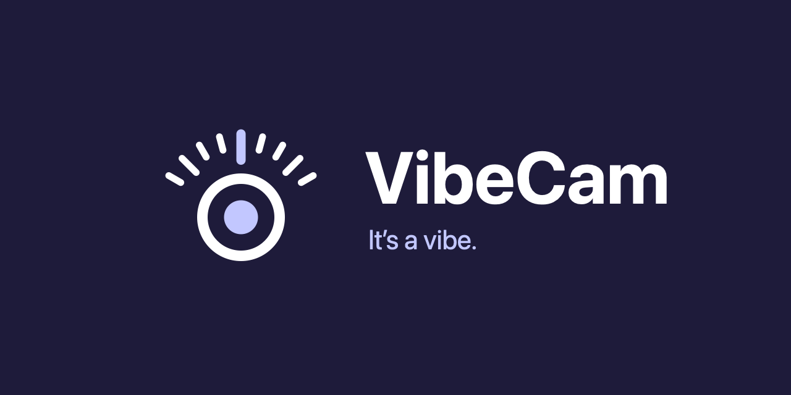
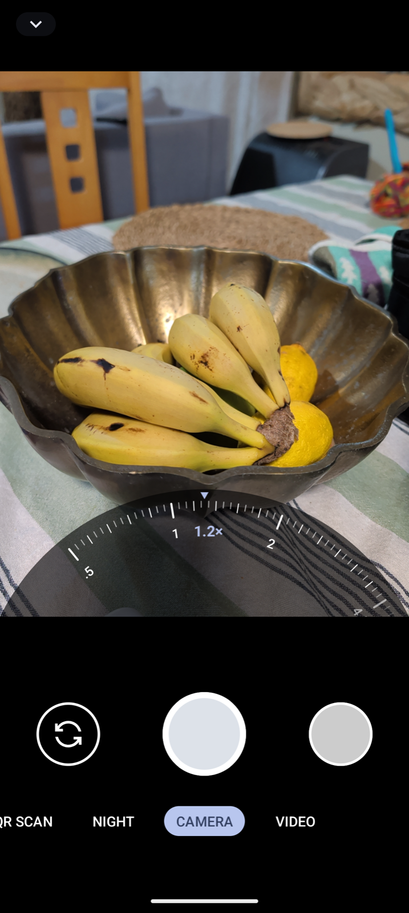

# VibeCam



**It's a vibe.** A polished, open-source camera app for Android, built on GrapheneOS Camera.



VibeCam keeps the privacy-first foundation of the GrapheneOS camera and adds the feel of a flagship phone camera, starting with an iPhone-style zoom dial that adapts to your phone's lenses.

- **Zoom dial:** swipe or long-press the lens shortcuts to open a dial, with a stop where each lens takes over.
- **Adapts to your phone:** reads the lenses your camera reports instead of assuming a model, and tells you when that data does not add up.
- **No network access:** the app does not request the internet permission, so there are no ads, no tracking and nothing leaves your phone.
- **Your choice:** the dial is a setting. Turn it off in More Settings to get the original zoom slider back.

VibeCam has only been tested on a Pixel 10 Pro running GrapheneOS (a "Ghost Phone"). Efforts have been made to have it adapt to any Android phone, but your mileage may vary on other devices. Support for phones that expose each rear lens as a separate camera is experimental and untested on real hardware.

## Install

Coming soon: signed releases you can install with [Obtainium](https://wiki.obtainium.imranr.dev/). Once the first release is published, copy this repository's GitHub URL into Obtainium and it will install the app and keep it up to date for you. Until then, the app has to be built from source.

## Keep Android open

Your ownership of your own device is under threat. Google is actively working to remove your right to install the apps you choose, so you may be blocked from side-loading at some point, that is, from installing apps like this one outside their app store.

VibeCam only exists because Android still lets you install software that did not come from Google. To learn what is changing and what you can do about it, visit [keepandroidopen.org](https://keepandroidopen.org/).

## Build from source

You need JDK 17 and the Android SDK. Then:

```bash
./gradlew :app:assembleDebug
```

The debug build installs as `tech.extrabox.vibecam.dev`, beside any other camera app.

## Credits and licence

VibeCam is an independent fork of [GrapheneOS Camera](https://github.com/GrapheneOS/Camera) and is not affiliated with or endorsed by the GrapheneOS project. All credit for the camera underneath goes to its authors.

The source code is under the MIT licence in `LICENSE`. The VibeCam name and icon are not covered by it; see `branding/README.md`.
